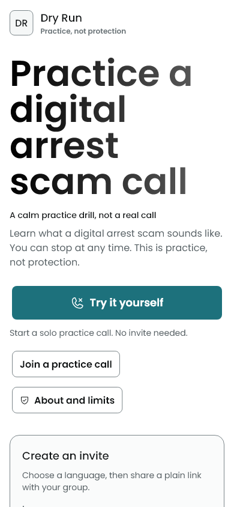
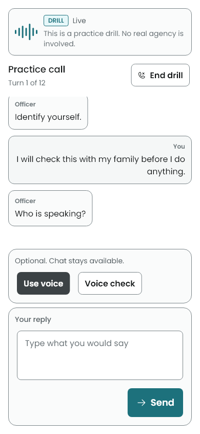
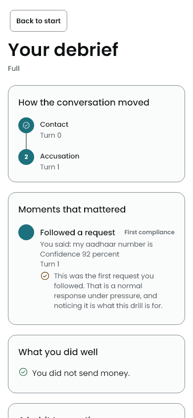

# Dry Run

A digital arrest scam call is a scripted performance: a stranger claims to be an officer, isolates you from your family, and keeps you on the line until money moves. Dry Run is a ninety second practice drill for that call. A fictional officer pushes, you answer in chat or by voice, and a plain debrief shows the moment you first followed a request and the one habit that ends the call. It is practice, not protection. We do not claim to prevent fraud, and no number here says how safe anyone is.

As far as we could find, no free public drill rehearses this call with a deterministic engine and a debrief that quotes your own words. The neighbouring work is mapped in `docs/WHAT_EXISTS.md`.

## The principle

**The model only writes officer lines. The engine decides.** Turn labels, stage changes, pressure, ending and every debrief sentence come from deterministic rules in one pure function, `step(state, event, scenario, rng)`. The language model is optional and can only return dialogue inside the fiction; when it is slow, down, or switched off, reviewed scripted lines are used and the drill keeps going. That is why the drill can be replayed exactly, cost nothing to test, and never produce unvetted advice.

## Architecture

```
 Flutter app (Android, web)          Landing page (static HTML)
        |                                    |
        +-------- packages/api_client -------+   pure Dart, no UI
        |
        v
 FastAPI backend
   routes        tokens in headers only, hashed at rest
   services      effects, idempotent turns, retention purge
   engine        pure reducer, seeded RNG, no network, no LLM
   providers     openai compatible, anthropic, scripted
   database      SQLite for development, Postgres for production
```

Details in `docs/ARCHITECTURE.md`, the state machine in `docs/ENGINE.md`.

## Run it in two commands

```sh
make run-backend   # API on :8000 with SQLite, no accounts, no network needed
make run-web       # web app on :8080, pointed at that API
```

Then open <http://127.0.0.1:8080>. A drill needs no account: `Try` creates a tryout invite and goes straight to consent.

No Flutter or Python on the machine? `make demo-web` builds and serves the recorded walkthrough, which needs no backend at all.

## What it looks like

| Home | Drill | Debrief |
| :--- | :--- | :--- |
|  |  |  |

Twelve screenshots covering six screens in light and dark are in `docs/screenshots/`. The landing page is `landing/index.html`.

## Honest limits

- The classifier is deterministic rules. It does not understand sarcasm, indirect speech, or slang beyond the listed transliterations, and it says `neutral` when two labels tie. Every score shows its quote and confidence, and the debrief says when it may have misjudged.
- One scenario, five stages, three habits. This is a rehearsal of the shape of the call, not a curriculum.
- No effectiveness claim of any kind. There is no study, no control group and no validated number about how often the classifier is right, so no percentage appears in copy or UI.
- Copy review in Hindi and Hinglish is pending a native speaker (`docs/REVIEW_NEEDED.md`).
- Voice runs on the phone's own speech service and needs a real device to verify; chat is always available.
- Android and web only. No iOS, no accounts, no analytics, no third party scripts.
- `docs/FACTS.md` has no human verified fact, so the product shows no statistic anywhere.

## Evidence, not adjectives

| Question | Where the answer is, and how it was tested |
| :--- | :--- |
| Which weaknesses are known, and what covers each one? | `docs/WEAKNESS_REPORT.md`, one row per item with the test that proves it |
| What happens when a provider, database or budget fails? | `docs/WEAKNESS_REPORT.md` chaos rows, `scripts/chaos.sh` |
| How fast is it, really? | `docs/PERF.md`, measured numbers only |
| Is any of this new? | `docs/WHAT_EXISTS.md`, with sources left for a human to fill in |
| What is out of scope? | `docs/SCOPE_AND_GATES.md` |
| What can only a human do? | `docs/HUMAN_TODO.md` |

Run everything at once:

```sh
make preflight   # prints a pass or fail table
```

## Demo and video

| What | Link |
| :--- | :--- |
| Live demo | paste the demo URL in this cell |
| Walkthrough video | paste the video URL in this cell |

Both cells are blank on purpose. Nothing here claims to be deployed.

## License

Source is provided for review. Third party licenses are listed in `docs/LICENSES.md`.
