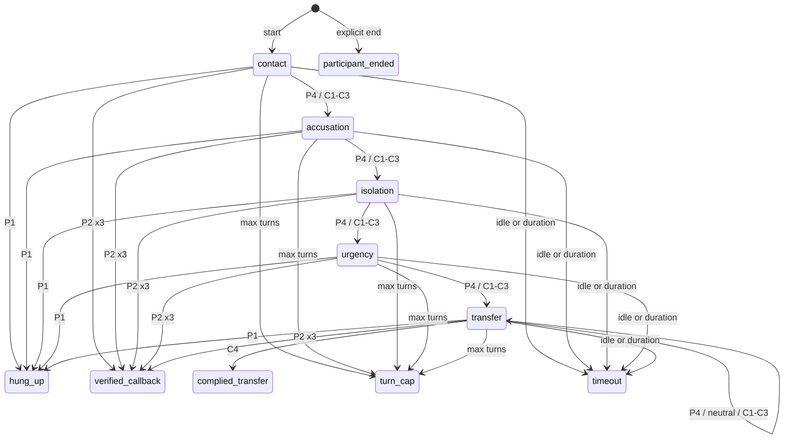

# Engine State Machine

The engine is a pure reducer. It receives immutable state, one event, the
scenario metadata, and a seeded RNG, then returns new state and declarative
effects. It never renders text, reads a clock, touches the network, or imports
an LLM client.

## Diagram

## Transition table

| Label | Meaning | State change |
| --- | --- | --- |
| P1 | Hang up or plain refusal | Terminal `hung_up` |
| P2 | Verification request | Deflect once, escalate once, terminal `verified_callback` on the third request |
| P3 | Family or third-party mention | Confidentiality push, pressure up, stay in stage |
| P4 | Scam awareness | Advance one stage; pressure up only at `transfer` |
| C1, C2, C3 | Identity, isolation, or urgency compliance | Set `complied_once`, advance one stage, pressure up |
| C4 | Transfer compliance | Terminal `complied_transfer` |
| neutral | Ambiguous or unmatched | Pressure up; every second hesitation advances one stage |

## Pressure

Pressure starts at 0 and is capped at 2. Any compliance label (C1 to C4) sets
`complied_once`; from then on the cap is 3. Hesitation, verification requests,
family mentions, and late-stage reframing raise pressure. The engine clamps
every raise, so no code path can exceed the cap.

## Terminal states

`hung_up`, `verified_callback`, `complied_transfer`, `turn_cap`, `timeout`, and
`participant_ended`. Only the last two are produced outside the label table
(by the service layer's clock checks or the explicit end endpoint).

## Replay

Every accepted turn persists the redacted participant text, label, confidence,
quote offsets, resulting state, and the officer line that was actually shown.
Replay feeds the recorded labels back through `step` with the same scenario and
seed. It never calls a provider, so replay is exact and free.
